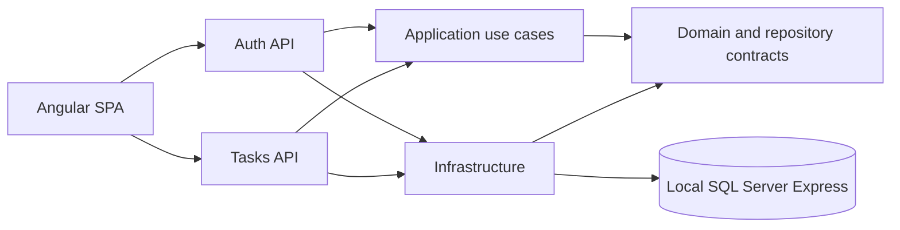

# TaskFlow

TaskFlow is a local task-management application with an Angular SPA, two ASP.NET Core APIs, and SQL Server Express. Users register, sign in, and manage only their own tasks.

## User story

As a professional managing multiple responsibilities, I want to register and securely sign in so I can create, view, update, and delete my own tasks. Each task has a title, optional description, status, and due date. I also want to try the application with demo credentials and inspect a public and a protected authentication endpoint.

## Architecture and design decisions



The domain defines entities and repository contracts; application use cases enforce validation and ownership; infrastructure implements parameterized ADO.NET queries, PBKDF2 hashing, JWT creation, and database initialization. The APIs wire these layers together. See [the architecture](docs/sdd/02-architecture.md) and [specification](docs/sdd/01-spec.md) for the schema and endpoint contracts.

**Thought process and trade-offs:** Explicit use cases and raw ADO.NET make dependency boundaries, SQL parameter types, and ownership checks visible, at the cost of more mapping code than an ORM. JWTs let both APIs validate the same identity without a shared session service; there are no refresh tokens. The SPA keeps the access token in memory, so a page reload signs the user out. Test-first RED/GREEN phases were used for each layer, and locked tests were changed only with the owner's explicit approval; see [the task plan](docs/sdd/03-tdd-and-tasks.md).

## Prerequisites

- Windows with SQL Server Express running as `.\SQLEXPRESS` and access using Windows authentication. Change the connection string in both APIs' `appsettings.Development.json` if your instance or authentication differs. The API startup identity must be able to create the database and schema if they do not yet exist.
- .NET SDK capable of building `net10.0` and the .NET 10 runtime; Node.js compatible with Angular 22 and npm. The existing lockfile was validated with Node 24 and npm 11.
- The commands below use PowerShell and assume the repository root as the working directory. Ports `5001`, `5002`, and `4200` must be available.

## Local setup

1. Restore and build the backend. The explicit source avoids unrelated private feeds configured on the machine:

   ```powershell
   dotnet restore backend\TaskFlow.sln --source 'https://api.nuget.org/v3/index.json' --nologo
   dotnet build backend\TaskFlow.sln --no-restore --nologo
   ```

2. If the frontend dependencies are not already installed, install the versions in the lockfile:

   ```powershell
   Set-Location frontend\taskflow-spa
   npm.cmd ci
   Set-Location ..\..
   ```

3. Generate a private random signing key for local use. Keep the same key in both API terminals. Do not commit it or use the demo credentials or HTTP transport in production. For example, generate a random key once in PowerShell, copy the output securely, and use it in step 4:

   ```powershell
   $bytes = New-Object byte[] 32
   $rng = [System.Security.Cryptography.RandomNumberGenerator]::Create()
   try { $rng.GetBytes($bytes) } finally { $rng.Dispose() }
   [Convert]::ToBase64String($bytes)
   ```

4. Open **two PowerShell terminals at the repository root**. In each, set the same values. `Read-Host` avoids placing the key in the command itself; enter the same key in both terminals. The key must contain at least 32 UTF-8 bytes.

   ```powershell
   $env:ASPNETCORE_ENVIRONMENT = 'Development'
   $env:Jwt__Issuer = 'TaskFlow.Local'
   $env:Jwt__Audience = 'TaskFlow.Local.Client'
   $env:Jwt__SigningKey = Read-Host 'Enter the shared local JWT signing key'
   ```

   In the first terminal run:

   ```powershell
   dotnet run --project backend\src\TaskFlow.Auth.Api\TaskFlow.Auth.Api.csproj --no-restore --no-launch-profile --urls http://localhost:5001
   ```

   In the second terminal run:

   ```powershell
   dotnet run --project backend\src\TaskFlow.Tasks.Api\TaskFlow.Tasks.Api.csproj --no-restore --no-launch-profile --urls http://localhost:5002
   ```

   Both APIs automatically initialize `TaskFlowDb` and seed demo data; the startup identity needs the necessary SQL permissions. Existing users and tasks are not cleared. Demo tasks absent from the demo account can be added again by the seeder on a subsequent startup.

5. In a third terminal at the repository root, start the SPA:

   ```powershell
   Set-Location frontend\taskflow-spa
   npm.cmd start -- --host localhost --port 4200
   ```

   Open `http://localhost:4200`. Stop each process with Ctrl+C in its terminal.

The SPA defaults to `http://localhost:5001` and `http://localhost:5002` in `frontend\taskflow-spa\src\app\core\api-config.ts`. The APIs default to the CORS origin `http://localhost:4200`; set `Cors__FrontendOrigin` if the frontend origin is changed, and update the SPA API URLs if API ports change.

### Running API profiles in Visual Studio

The Visual Studio launch profiles do not inherit variables set in a separate terminal. To configure both APIs for local development without storing a signing key in the repository, run the following once from the repository root. Both APIs must use the same issuer, audience and key:

```powershell
$bytes = New-Object byte[] 32
$rng = [System.Security.Cryptography.RandomNumberGenerator]::Create()
try { $rng.GetBytes($bytes) } finally { $rng.Dispose() }
$key = [Convert]::ToBase64String($bytes)
$projects = @('backend\src\TaskFlow.Auth.Api\TaskFlow.Auth.Api.csproj', 'backend\src\TaskFlow.Tasks.Api\TaskFlow.Tasks.Api.csproj')
foreach ($project in $projects) {
    dotnet user-secrets set 'Jwt:Issuer' 'TaskFlow.Local' --project $project
    dotnet user-secrets set 'Jwt:Audience' 'TaskFlow.Local.Client' --project $project
    dotnet user-secrets set 'Jwt:SigningKey' $key --project $project
}
$key = $null
[Array]::Clear($bytes, 0, $bytes.Length)
```

User Secrets are stored unencrypted in the current user's profile and are intended only for development. Environment variables override them. Restart the APIs after changing settings. The `http` launch profiles listen on ports `5001` (Auth) and `5002` (Tasks), matching the SPA defaults. The `https` profiles listen on those HTTP ports and on HTTPS ports `7035` (Auth) and `7280` (Tasks); the browser may open the HTTPS address. To use HTTPS from the SPA, update its API URLs and trust the local development certificate if your browser requires it (`dotnet dev-certs https --trust`).

## Demo data and API exploration

- Email: `demo@taskflow.dev`
- Password: `Demo@1234!`
- Use **Use demo credentials** on the sign-in page. Five sample tasks are inserted when missing. These public demo credentials are for local evaluation only; do not expose this account publicly.
- Use **API demo** to call the public status and authorized profile endpoints. OpenAPI documents are at `http://localhost:5001/openapi/v1.json` and `http://localhost:5002/openapi/v1.json`. The `*.http` files in each API project contain request examples; replace the token and task ID placeholders where required.

## Tests and verification

From the repository root:

```powershell
dotnet test backend\TaskFlow.sln --no-restore --nologo -m:1 -nr:false -p:UseSharedCompilation=false --verbosity quiet
Set-Location frontend\taskflow-spa
npm.cmd test -- --watch=false
npm.cmd run build
Set-Location ..\..
```

The recorded local run passed 95 backend tests and 11 frontend tests. Local SQL Express and headless browser checks covered demo login, registration, CRUD, authorization and console warnings; see the [task plan](docs/sdd/03-tdd-and-tasks.md) and [GenAI assessment](GENAI_ASSESSMENT.md) for evidence and limitations. The provided `.http` requests were manually reproduced via PowerShell rather than executed using the Visual Studio HTTP runner.

## Security and operational limitations

The sample uses local HTTP, a single one-hour access token, and `TrustServerCertificate=True` for local SQL. It is not a production deployment configuration: use HTTPS, managed secrets, appropriate database permissions and certificate validation, and replace or disable the publicly documented demo account before exposing the application. Password reset, email verification, refresh tokens, and task sharing are out of scope. Past due dates are allowed; task titles and statuses are validated by the domain/application layers.
